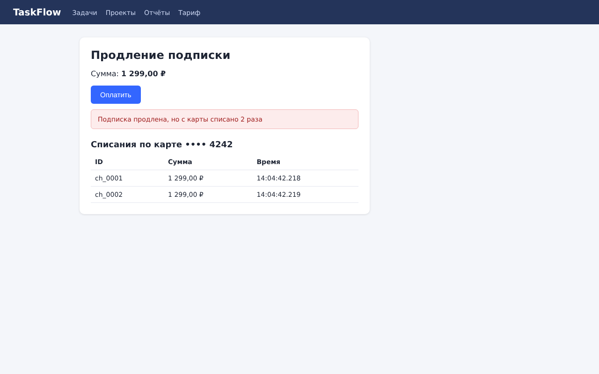
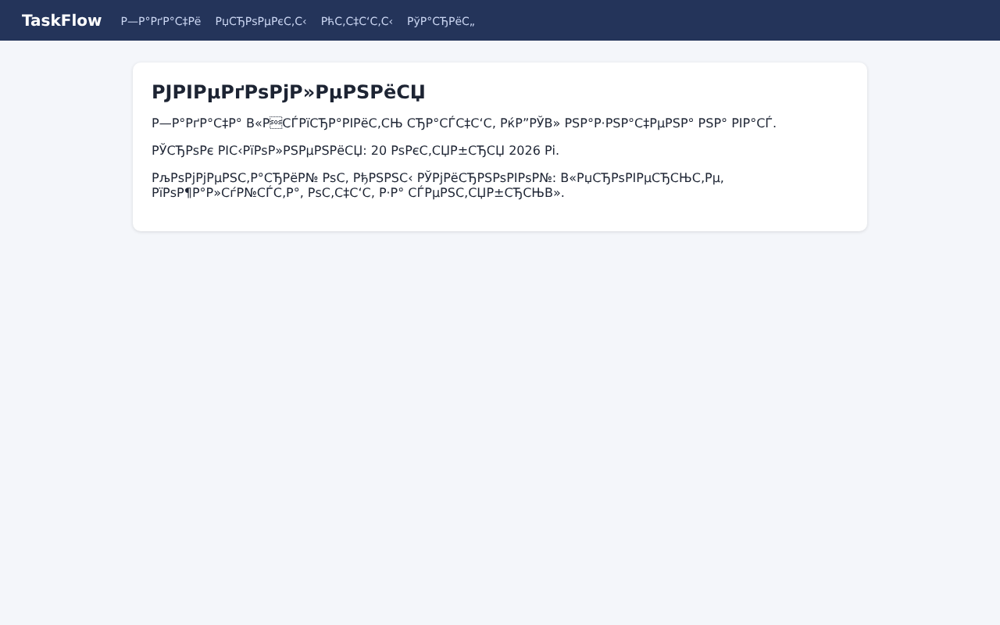
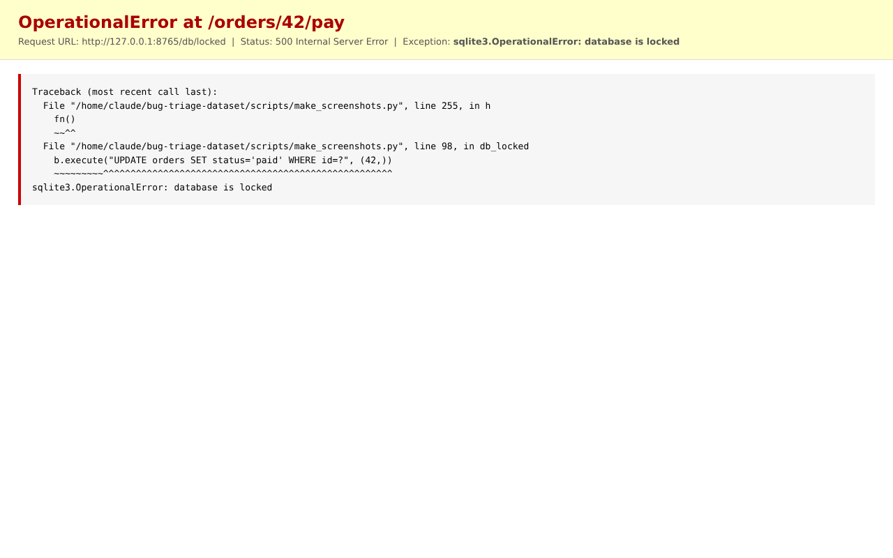
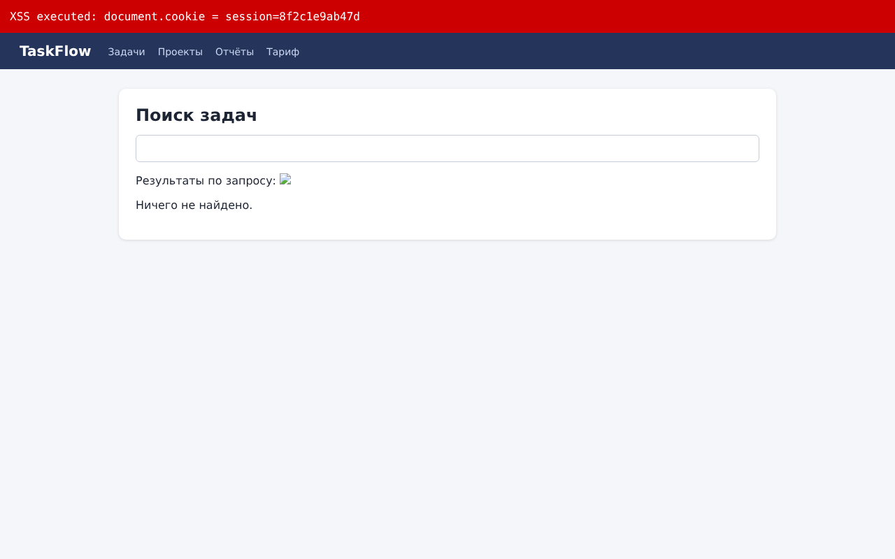

# Bug Triage Dataset — мультимодальные данные для автоматической классификации баг-репортов

Набор неструктурированных данных для будущей системы ИИ, которая по входящему
баг-репорту автоматически определяет **категорию дефекта и компонент системы**
(Backend, Frontend, Auth-service, Billing, Database), **критичность**
(Blocker, Critical, Major, Minor) и команду-исполнителя.

Репозиторий подготовлен в рамках Лабораторной работы №1 «Подготовка
неструктурированных данных» (учебное пособие «Структурирование, разметка и
обогащение данных», Муромцев Д.И., Шилин И.А., Исаев И.В.), шаги 3–4.

Данные собраны в **трёх модальностях** для **10 объектов** — категорий
программных дефектов:

| № | Категория (`id`) | Описание | Компонент |
|---|---|---|---|
| 1 | `crash` | Падения и необработанные исключения | Backend |
| 2 | `ui_layout` | Вёрстка и отображение интерфейса | Frontend |
| 3 | `authentication` | Аутентификация и авторизация | Auth-service |
| 4 | `payment` | Ошибки оплаты и биллинга | Billing |
| 5 | `database` | Ошибки базы данных и транзакций | Database |
| 6 | `network` | Сеть и соединения | Backend |
| 7 | `performance` | Производительность и зависания | Backend |
| 8 | `memory` | Утечки памяти и OutOfMemory | Backend |
| 9 | `localization` | Локализация и кодировки | Frontend |
| 10 | `security` | Уязвимости и TLS/сертификаты | Backend |

| Модальность | Что это | Объём |
|---|---|---|
| Текст | реальные баг-репорты из открытых трекеров + фрагменты реальных системных логов | 100 репортов (по 10 на категорию), 12 лог-файлов |
| Изображения | скриншоты воспроизведённых дефектов | 30 PNG (по 3 на категорию) |
| Аудио | голосовые обращения пользователей в поддержку | 20 WAV (по 2 на категорию), 4,4 мин |

---

## Структура репозитория

```
bug-triage-dataset/
├── README.md                     ← этот файл
├── LICENSE                       ← лицензии кода и данных
├── requirements.txt              ← зависимости Python
├── .gitignore
├── data/                         ← ДАННЫЕ (по подпапке на модальность, внутри — по категориям)
│   ├── text/
│   │   ├── bug_reports/<категория>/<проект>-<id>.json   ← 1 файл = 1 баг-репорт
│   │   ├── bug_reports.csv       ← все 100 репортов одной таблицей
│   │   ├── logs/<категория>/<система>_<категория>.log  ← фрагменты логов LogHub
│   │   └── logs.csv              ← откуда взят каждый фрагмент (файл, строки, regex)
│   ├── images/
│   │   ├── screenshots/<категория>/<категория>_NN_<что>.png
│   │   └── images.csv            ← описание каждого скриншота и способ получения
│   ├── audio/
│   │   ├── voice_reports/<категория>/<категория>_NN.wav
│   │   └── audio.csv             ← длительность, голос, эталонная расшифровка
│   └── checksums.sha256          ← контрольные суммы всех файлов данных
├── scripts/                      ← КОД сбора и проверки данных
│   ├── download_sources.sh       ← скачивание исходных датасетов (git clone)
│   ├── categories.py             ← справочник 10 категорий и правила отнесения
│   ├── collect_text.py           ← отбор баг-репортов и фрагментов логов
│   ├── make_screenshots.py       ← тестовый стенд + съёмка скриншотов дефектов
│   ├── synth_audio.py            ← синтез голосовых обращений
│   └── validate_dataset.py       ← проверка корректности загрузки (шаг 4.3)
└── docs/                         ← ДОКУМЕНТАЦИЯ
    ├── data_card.md              ← описание полей и особенностей данных
    └── validation_report.md      ← результат последней проверки
```

Во всех модальностях используются одинаковые имена категорий, поэтому данные
об одном объекте легко найти в каждой из них: например, всё про утечки памяти
лежит в `data/text/bug_reports/memory/`, `data/text/logs/memory/`,
`data/images/screenshots/memory/` и `data/audio/voice_reports/memory/`.

---

## Источники данных

| Модальность | Источник | Ссылка | Лицензия |
|---|---|---|---|
| Текст — баг-репорты | **GitBugs** (Patil, 2025): выгрузки из Apache Jira (Spark, Hadoop, HBase, Cassandra), Mozilla Bugzilla (Firefox, Thunderbird, SeaMonkey) и GitHub Issues (VS Code) | https://github.com/av9ash/gitbugs, статья: https://arxiv.org/abs/2504.09651 | CC BY 4.0 |
| Текст — логи | **LogHub** (Zhu et al., ISSRE 2023): логи OpenSSH, Linux, Hadoop, HDFS, Spark, Zookeeper, OpenStack, Android, Thunderbird | https://github.com/logpai/loghub | бесплатно для исследований и обучения |
| Изображения | собственный тестовый стенд «TaskFlow» (вымышленный сервис), браузер Chromium через Playwright | `scripts/make_screenshots.py` | CC BY 4.0 (автор репозитория) |
| Аудио | синтез речи **espeak-ng** по сценариям обращений в поддержку | https://github.com/espeak-ng/espeak-ng | записи — CC BY 4.0; движок — GPLv3 |

Дополнительно просмотрены, но не использованы: BugRepo (https://github.com/logpai/bugrepo)
— те же проекты, что в GitBugs, но более старые (до 2018 г.); OwlEye
(https://github.com/20200501/OwlEye) — датасет скриншотов с UI-дефектами, но
изображения хранятся в Git LFS и были недоступны для загрузки.

**Почему изображения и аудио получены так.** Скриншоты к баг-репортам в
публичных трекерах лежат во внешних хранилищах (GitHub user-attachments,
вложения Bugzilla) и не входят в открытые датасеты, а записи звонков в
поддержку содержат персональные данные и не публикуются. Поэтому:

* **скриншоты** сделаны так, как их делает QA-инженер: дефект *реально
  воспроизводится* на тестовом стенде и фиксируется браузером. Всё, что на них
  видно, — настоящее поведение программ: страницы ошибок Chromium
  (`ERR_NAME_NOT_RESOLVED`, `ERR_CONNECTION_REFUSED`, `ERR_CERT_AUTHORITY_INVALID`),
  трейсбеки Python и Node.js, исключения SQLite, выполнившийся XSS,
  «кракозябры» при неверной кодировке, двойное списание при двойном клике,
  рост JS-кучи при утечке и т.д.;
* **аудио** синтезировано: в `audio.csv` записан исходный текст каждого
  обращения — это эталонная расшифровка для будущей проверки распознавания речи.
  Синтетическая природа записей указана явно; при появлении реальных записей
  их можно добавить в те же папки.

---

## Описание кода

| Скрипт | Назначение |
|---|---|
| `scripts/download_sources.sh` | клонирует GitBugs и LogHub в папку `sources/` (она в `.gitignore`) |
| `scripts/categories.py` | 10 категорий, привязка к компонентам, регулярные выражения для отнесения репорта к категории по заголовку |
| `scripts/collect_text.py` | читает 8 выгрузок трекеров (~107 тыс. репортов), убирает пустые/слишком длинные описания и автоматические отчёты CI о нестабильных тестах, относит репорт к категории, отбирает по 10 на категорию (не более 3 из одного проекта, разные приоритеты, `seed=42`), вырезает из логов LogHub строки по категориям |
| `scripts/make_screenshots.py` | поднимает локальные HTTP/HTTPS-серверы стенда, запускает ошибочный код, открывает страницы в Chromium и сохраняет 30 скриншотов + `images.csv` |
| `scripts/synth_audio.py` | синтезирует 20 обращений (5 голосов, разный темп), приводит к WAV 16 кГц моно с полосой телефонного канала (200–3800 Гц), пишет `audio.csv` |
| `scripts/validate_dataset.py` | проверяет корректность данных (см. ниже) и пишет `docs/validation_report.md` |

### Установка и запуск

```bash
# 1. Зависимости
python -m pip install -r requirements.txt
python -m playwright install chromium
# для аудио: espeak-ng и ffmpeg (Ubuntu: sudo apt install espeak-ng ffmpeg; Windows: установщики с GitHub)
# для скриншотов памяти/падений Node.js: node >= 18

# 2. Исходные датасеты
bash scripts/download_sources.sh

# 3. Сбор данных (каждый шаг можно запускать отдельно)
python scripts/collect_text.py --sources sources --out data/text --per-category 10
python scripts/make_screenshots.py --out data/images/screenshots
python scripts/synth_audio.py --out data/audio/voice_reports

# 4. Проверка
python scripts/validate_dataset.py --update-checksums   # после пересборки данных
python scripts/validate_dataset.py                      # проверка уже загруженных данных
```

Скрипты проверялись на Python 3.13, Playwright 1.56 (Chromium 141), Node.js 22,
espeak-ng 1.53.

---

## Примеры данных

### Текст — баг-репорт (`data/text/bug_reports/memory/hbase-13375331.json`, сокращено)

```json
{
  "report_id": "hbase-13375331",
  "category": "memory",
  "component_hint": "Backend",
  "source_project": "hbase",
  "tracker": "Apache Jira",
  "summary": "Memory leak from thrift server hashMap",
  "description": "I found when the scanner does not closed successfully, it remains forever in the hashMap that stores the state of the scanner. ...",
  "priority_original": "Minor",
  "severity_prelabel": "Minor",
  "license": "CC BY 4.0 (GitBugs, Patil 2025)"
}
```

Поля `category`, `component_hint` и `severity_prelabel` — **предразметка**,
полученная автоматически (по ключевым словам и по исходному приоритету
трекера). Это «примерная разметка» для полуавтоматической разметки в
Label Studio (см. задание 2); окончательные метки ставит разметчик.

### Текст — лог (`data/text/logs/authentication/openssh_authentication.log`)

```
Dec 10 06:55:46 LabSZ sshd[24200]: Invalid user webmaster from 173.234.31.186
Dec 10 06:55:46 LabSZ sshd[24200]: pam_unix(sshd:auth): authentication failure; logname= uid=0 euid=0 tty=ssh ruser= rhost=173.234.31.186
Dec 10 06:55:48 LabSZ sshd[24200]: Failed password for invalid user webmaster from 173.234.31.186 port 38926 ssh2
```

### Изображения

| `payment_03_double_charge.png` | `localization_01_mojibake_cp1251.png` |
|---|---|
|  |  |
| Кнопка «Оплатить» не блокируется — двойной клик создал два платежа | Страница в UTF-8 отдана с `charset=windows-1251` |

| `database_01_sqlite_database_locked.png` | `security_03_reflected_xss.png` |
|---|---|
|  |  |
| `sqlite3.OperationalError: database is locked` при оплате заказа | Отражённый XSS: внедрённый скрипт прочитал `document.cookie` |

### Аудио (`data/audio/audio.csv`, первая строка)

| file | duration_sec | voice | transcript |
|---|---|---|---|
| `crash/crash_01.wav` | 17.49 | ru | «Здравствуйте. Приложение закрывается само, как только я открываю заказ номер сорок два…» |

Формат: WAV, PCM 16 бит, моно, 16 кГц.

---

## Проверка корректности данных

`scripts/validate_dataset.py` проверяет, что для каждой категории есть данные
всех трёх модальностей; каждый JSON читается и содержит обязательные поля;
каждый PNG открывается и не повреждён; каждый WAV — моно 16 кГц длительностью
больше 2 с; CSV-метаданные описывают все файлы и только существующие;
SHA-256 всех 166 файлов данных совпадают с `data/checksums.sha256`.
Результат последней проверки — в [docs/validation_report.md](docs/validation_report.md).

---

## Лицензия

* Код (`scripts/`) — MIT.
* Баг-репорты — CC BY 4.0, источник GitBugs (Patil A. *GitBugs: Bug Reports for
  Duplicate Detection, Retrieval Augmented Generation, Triage, and More*, 2025).
* Фрагменты логов — по условиям LogHub (свободно для исследовательских и
  учебных целей, со ссылкой на Zhu J. et al. *Loghub: A Large Collection of
  System Log Datasets for AI-driven Log Analytics*, ISSRE 2023).
* Скриншоты и аудиозаписи — CC BY 4.0.

Подробнее — в [LICENSE](LICENSE).

## Контакты

Автор: lebowskiybig — lebowskiybig@gmail.com.
Вопросы и предложения — через Issues репозитория или по почте.

## Презентация

Презентация проекта готовится на шаге 5 лабораторной работы; ссылка будет
добавлена сюда.
