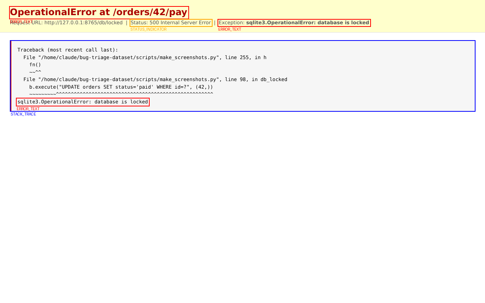

# Аннотационная схема Bug Triage Dataset

Версия 1.0 от 17.10.2026. Лабораторная работа №2 «Проектирование аннотационной схемы»
(учебное пособие «Структурирование, разметка и обогащение данных», Муромцев Д.И., Шилин И.А., Исаев И.В.).

Машиночитаемая версия схемы — [`annotation_schema/schema.json`](../annotation_schema/schema.json).
Из неё генерируются конфигурации Label Studio и по ней же проверяются аннотации
(`scripts/annotation_tools.py`), поэтому при изменении меток правится только этот файл.

**Назначение.** Схема описывает, что и как размечать в собранных данных, чтобы обучить систему,
которая по входящему обращению определяет **категорию дефекта, компонент системы, критичность и
команду-исполнителя**, а также извлекает технические сущности (исключение, место в коде,
окружение). Схема одна для всех модальностей: сущность `EXCEPTION` выглядит одинаково в тексте
репорта, в строке лога, в надписи на скриншоте и в расшифровке звонка.

Содержание:

1. [Состав аннотационной схемы](#1-состав-аннотационной-схемы)
2. [Требования к аннотациям](#2-требования-к-аннотациям)
3. [Формальные и содержательные требования](#3-формальные-и-содержательные-требования)
4. [Уровни аннотаций](#4-уровни-аннотаций)
5. [Форматы аннотаций](#5-форматы-аннотаций)
6. [Верификация аннотаций](#6-верификация-аннотаций)
7. [Размещение в репозитории](#7-размещение-в-репозитории)

---

## 1. Состав аннотационной схемы

### 1.1. Модальности

| Модальность | Данные (из ЛР1) | Роль в системе |
|---|---|---|
| **Текст — баг-репорты** | 100 репортов из Apache Jira, Mozilla Bugzilla, GitHub Issues | основной вход: классификация тикета и извлечение сущностей |
| **Текст — логи** | 12 фрагментов логов LogHub | технический контекст: события сбоев, исключения, адреса |
| **Изображения** | 30 скриншотов дефектов | вспомогательный вход: текст ошибки на экране, место визуального дефекта |
| **Аудио** | 20 голосовых обращений в поддержку | вход из колл-центра: расшифровка, смысловые сегменты, сущности |

### 1.2. Основные сущности и объекты

Выделено семь групп объектов, которые размечаются в данных:

1. **Классы обращения** — тип тикета, категория дефекта, компонент, критичность (весь документ или файл).
2. **Структура обращения** — разделы репорта (шаги, ожидаемое, фактическое, окружение, трассировка),
   смысловые сегменты звонка.
3. **Технические сущности ошибки** — тип исключения, текст ошибки, место в коде, код ошибки.
4. **Окружение** — ОС, браузер, устройство, версия приложения, библиотека, СУБД.
5. **Интерфейс** — элементы интерфейса, связанные с дефектом, и места визуальных дефектов.
6. **Метрики** — время, память, количество (для производительности и утечек памяти).
7. **Персональные данные (PII)** — имена, адреса IP, логины, номера карт; размечаются, чтобы
   замаскировать их перед публикацией и обучением.

### 1.3. Сводная таблица: группы объектов × модальности

| Модальность ↓ / Группа → | Классы обращения | Структура | Технические сущности | Окружение | Интерфейс | Метрики | PII |
|---|---|---|---|---|---|---|---|
| **Текст: баг-репорт** | ticket_type, category, component, severity | разделы `TITLE…NOTES`, элементы `STEP`, `FRAME` | `EXCEPTION`, `ERROR_MESSAGE`, `CODE_LOCATION`, `ERROR_CODE` | `ENV` | `UI_ELEMENT` | `METRIC` | `PII` |
| **Текст: лог** | category, system (файл) | строка = событие: level, event_type, is_anomaly | те же метки в строке | `ENV` | — | `METRIC` | `PII` (ip, host, username) |
| **Изображение** | category, component, screen_type | области `ERROR_TEXT`, `STACK_TRACE`, `STATUS_INDICATOR` | сущности в тексте области (ocr_text) | — | области `UI_ELEMENT`, `DEFECT_AREA` | сущности в ocr_text | область `PII` |
| **Аудио** | category, component, severity, urgency | сегменты `GREETING…CLOSING`, транскрипция | сущности в транскрипции | `ENV` в транскрипции | `UI_ELEMENT` в транскрипции | `METRIC` в транскрипции | `PII` (имя звонящего) |

---

## 2. Требования к аннотациям

### 2.1. Классы обращения (общие для всех модальностей)

| Поле | Значения | Обязательность |
|---|---|---|
| `ticket_type` | `bug`, `feature_request`, `question`, `not_a_bug` | тексты |
| `category` | `crash`, `ui_layout`, `authentication`, `payment`, `database`, `network`, `performance`, `memory`, `localization`, `security`, `other` | все модальности |
| `component` | `Backend`, `Frontend`, `Auth-service`, `Billing`, `Database` | все модальности |
| `severity` | `Blocker`, `Critical`, `Major`, `Minor` | тексты и аудио; только если `ticket_type = bug`, иначе `null` |
| `confidence` | `high`, `low` | тексты; `low` отправляет тикет второму разметчику |
| `team` | вычисляется из `component`: Backend→team-core, Frontend→team-web, Auth-service→team-auth, Billing→team-payments, Database→team-data | не размечается |

**Критерии критичности** (одинаковы для текста и аудио):

| Уровень | Когда ставить | Пример из данных |
|---|---|---|
| **Blocker** | ключевой сценарий (вход, оплата, сохранение) недоступен всем или большинству без обходного пути; потеря или порча данных; потеря денег; эксплуатируемая уязвимость | двойное списание при оплате (`payment_03`), отражённый XSS (`security_03`) |
| **Critical** | падение сервиса или функции, ошибка 5xx, ключевая функция не работает у части пользователей, обходной путь сложен | «сервер отчётов падает с ошибкой пятьсот, воспроизводится каждый раз» (`crash_02`) |
| **Major** | функция работает неверно, но обходной путь есть; заметная деградация производительности; элемент интерфейса непригоден на части платформ | импорт платёжных данных не работает только на macOS (`firefox-1844035`) |
| **Minor** | косметический дефект, опечатка, неточный перевод, вёрстка без блокировки действий, редкий случай | утечка памяти в редком сценарии с предложенным исправлением (`hbase-13375331`) |

**Компонент определяется по месту дефекта, а не по категории.** Предразметка `component_hint`
выводится из категории (например, `crash → Backend`), но разметчик меняет её, если дефект
находится в другом слое: NPE в JDBC-драйвере при чтении из Oracle — категория `crash`,
компонент `Database` (эталон `spark-13547998`).

### 2.2. Требования к тексту баг-репорта

Что выделять:

- **разделы** документа (`section`): `TITLE`, `DESCRIPTION`, `STEPS`, `EXPECTED`, `ACTUAL`,
  `ENVIRONMENT`, `STACK_TRACE`, `CODE`, `NOTES`;
- **элементы разделов** (`item`): `STEP` — один шаг воспроизведения, `FRAME` — один кадр стека;
- **сущности** (`entity`) и их атрибуты:

| Метка | Что это | Атрибуты | Примеры |
|---|---|---|---|
| `EXCEPTION` | тип исключения или ошибки | `normalized` (обяз.) — короткое имя класса | `java.lang.NullPointerException` → `NullPointerException` |
| `ERROR_MESSAGE` | текст сообщения об ошибке | — | `DataType time(7) is not supported.(line 1, pos 43)` |
| `CODE_LOCATION` | место в коде | `kind`: class / method / file / module / frame / variable; `normalized` | `JdbcUtils$.$anonfun$makeGetter$12(JdbcUtils.scala:452)` → frame, `JdbcUtils.scala:452` |
| `ERROR_CODE` | код ошибки | `kind`: http_status / net_error / exit_code / sql_state / app_code / cve; `normalized` | `500`, `ERR_CONNECTION_REFUSED`, `CVE-2021-44521` |
| `ENV` | окружение | `kind`: os / browser / device / runtime / app_version / library / database; `normalized`; `affected`: yes / no / unknown | `macOS 12` (affected=yes), `Ubuntu 22` (affected=no) |
| `UI_ELEMENT` | элемент интерфейса | `kind`: button / field / dialog / menu / page / link / list / other | `"Archive" button`, `migration window` |
| `METRIC` | число с единицей | `kind`: time / memory / cpu / count / size; `normalized` | `8 s`, `48 MB`, `2 раза` |
| `PII` | персональные данные | `kind`: person_name / email / ip / host / username / card / token / phone | `173.234.31.186`, `Олег`, `•••• 4242` |

- **связи** между сущностями: `HAS_MESSAGE` (EXCEPTION/ERROR_CODE → ERROR_MESSAGE),
  `THROWN_AT` (EXCEPTION → CODE_LOCATION, верхний кадр), `OBSERVED_IN` (проблема → ENV).

### 2.3. Требования к логам

- На уровне файла: `category` и `system` (уже известны из `logs.csv`).
- Каждая строка — событие: `level` (как в строке; `NONE`, если формат лога его не содержит),
  `event_type` (`auth_failure`, `invalid_user`, `break_in_attempt`, `connection_error`, `timeout`,
  `exception`, `resource`, `slow_operation`, `ui_event`, `other`), `is_anomaly` (сбой/атака или штатная работа).
- Внутри строки — те же сущности, что в тексте; чаще всего `PII` (ip, host, username),
  `EXCEPTION`, `CODE_LOCATION` (модуль: `pam_unix(sshd:auth)`), `METRIC`.
- Системные учётные записи (`root`) не считаются персональными данными, остальные логины — считаются.

### 2.4. Требования к изображениям

- На уровне изображения: `category`, `component`, `screen_type` (`error_page`, `browser_error`,
  `console`, `api_response`, `ui_screen`).
- Области (прямоугольные рамки):

| Метка области | Что выделять | Обязательные атрибуты |
|---|---|---|
| `ERROR_TEXT` | сообщение об ошибке | `ocr_text` |
| `STACK_TRACE` | блок трассировки или вывода программы | — |
| `STATUS_INDICATOR` | HTTP-статус, индикатор загрузки, счётчик | `ocr_text` |
| `DEFECT_AREA` | место визуального или логического дефекта | `defect_type`: overflow / overlap / wrong_layer / mojibake / untranslated / wrong_format / wrong_value / duplicate / endless_loading / other |
| `UI_ELEMENT` | элемент интерфейса, связанный с дефектом | `kind` |
| `PII` | персональные данные на экране | `kind` |

- Внутри `ocr_text` области размечаются сущности (`EXCEPTION`, `ERROR_CODE`, `ERROR_MESSAGE`, …)
  со смещениями относительно `ocr_text`.

### 2.5. Требования к аудио

- На уровне записи: `category`, `component`, `severity`, `urgency` (low / medium / high),
  `audio_quality` (clean / noisy / unintelligible), `synthetic` (true для записей espeak-ng).
- Слой `segment` — смысловые сегменты: `GREETING`, `PROBLEM`, `ERROR_DETAILS`, `STEPS`,
  `ENVIRONMENT`, `IMPACT`, `CLOSING`; паузы — пустая метка.
- Слой `transcript` — дословная расшифровка каждого сегмента.
- В тексте расшифровки — те же сущности, что и в тексте; `normalized` приводит произнесённое
  к канонической записи: «пятьсот» → `500`, «нулл пойнтер эксепшн» → `NullPointerException`.

### 2.6. Согласованность по типам сущностей

Чтобы аннотации разных модальностей были единообразны (шаг 2.2 работы):

1. **Один словарь меток.** Все модальности берут сущности из `entity_labels`, классы — из
   `document_labels` файла `schema.json`. Новой метки нельзя ввести в одной модальности,
   не добавив её в схему.
2. **Одинаковые имена категорий** с папками данных (`crash`, `memory`, …) — запись о категории
   можно найти во всех модальностях.
3. **Нормализация.** У сущностей с вариантами записи есть атрибут `normalized`, общий для всех
   модальностей: `NullPointerException` из трассировки, со скриншота и из звонка совпадают.
4. **Соответствие меток областей изображений меткам сущностей:** область `UI_ELEMENT` = сущность
   `UI_ELEMENT`, область `PII` = сущность `PII` с теми же значениями `kind`.
5. **Автоматическая проверка.** `annotation_tools.py validate` отклоняет метки и значения
   атрибутов вне словаря.

---

## 3. Формальные и содержательные требования

### 3.1. Формальные требования (форматы и структуры)

| Модальность | Структура аннотации | Координаты | Кодировка |
|---|---|---|---|
| Баг-репорт | JSON: `labels` + `sections` + `items` + `entities` + `relations` + `meta` | смещения символов Unicode в тексте `summary + "\n\n" + description`, начало включительно, конец исключительно (как в Python и Label Studio) | UTF-8 |
| Лог | JSON Lines: одна строка = одна строка лога (`line_no`, `text`, `level`, `event_type`, `is_anomaly`, `entities`) | смещения в пределах строки | UTF-8 |
| Изображение | COCO JSON: `images` (+ `attributes` уровня изображения), `categories` (метки областей), `annotations` | `bbox = [x, y, ширина, высота]` в пикселях, начало — левый верхний угол | UTF-8 |
| Аудио | Praat TextGrid (слои `segment`, `transcript`) + JSON (классы записи, сущности) | секунды от начала записи; интервалы идут встык от 0 до конца записи | UTF-8 |

Обязательные служебные поля каждой аннотации: `schema_version`, `meta.annotator`, `meta.created`,
`meta.status` (`draft` → `reviewed` → `gold`).

### 3.2. Содержательные требования

**Границы сущностей в тексте**

- Сущность не начинается и не заканчивается пробелом; не переходит на другую строку.
- Разметка трекеров (`{{…}}`, `{color:…}`, `**…**`, `` ` ``) в границы не входит.
- `EXCEPTION` — полное имя, как написано (`java.lang.NullPointerException`), короткое имя — в `normalized`.
- `CODE_LOCATION` с `kind=frame` — от имени класса до закрывающей скобки с номером строки, без `at `.
- `ERROR_MESSAGE` — без имени исключения и двоеточия перед сообщением.
- Каждое упоминание размечается отдельно (в `firefox-1844035` «Brave» размечен дважды).
- Предельная длина: `ERROR_MESSAGE` ≤ 300 символов, `CODE_LOCATION` ≤ 200, `ENV` ≤ 120,
  остальные ≤ 100. Более длинный фрагмент — признак того, что выделен не сущность, а раздел.

**Разделы**

- Первый раздел — всегда `TITLE`, совпадает с заголовком тикета.
- Разделы не пересекаются и покрывают весь непробельный текст: каждое слово репорта
  относится ровно к одному разделу.
- Заголовок раздела в тексте («Steps to reproduce:», `**Expected result**`) входит в раздел.
- Предусловия (Preconditions) относятся к `STEPS`, предложения по исправлению — к `NOTES`.

**Классы обращения**

- У каждого тикета ровно одно значение `ticket_type`, `category`, `component`; `severity` —
  ровно одно для `bug` и `null` для остальных типов.
- Если ни одна категория не подходит — `other`, а не «ближайшая».
- Ключевые слова-подсказки для категорий (из `scripts/categories.py`): `crash` — crash, segfault,
  NPE, core dump; `memory` — memory leak, OutOfMemory, heap; `network` — connection refused/reset,
  socket, proxy, DNS; `performance` — slow, hang, freeze, latency; `database` — database, JDBC,
  SQLite, deadlock, transaction; `authentication` — login, password, OAuth, Kerberos, token;
  `payment` — payment, billing, credit card, PayPal; `security` — CVE, XSS, injection, TLS,
  certificate; `localization` — locale, translation, i18n, encoding; `ui_layout` — layout,
  overlap, truncated, font, button, CSS. Подсказка не заменяет чтение текста: в
  `thunderbird-1643899` слово «PayPal» дало ложную категорию `payment`.

**Изображения**

- Рамка охватывает объект вплотную, допуск — 5 px; минимальная сторона — 8 px.
- Вложенные рамки допустимы (строка ошибки внутри блока `STACK_TRACE`).
- `ocr_text` — дословно, как на экране, включая регистр и пунктуацию; строки таблицы — через перевод строки.
- Маскированные данные (`•••• 4242`) всё равно размечаются как `PII`.

**Аудио**

- Минимальная длина сегмента — 0,3 с; допуск границы — 0,1 с.
- Граница сегмента ставится в паузе; паузы внутри одного смыслового сегмента (до 0,6 с) не выделяются.
- Расшифровка — дословно, числа словами, как произнесено; без исправления ошибок речи.
- Расшифровка сверяется с эталонным текстом в `audio.csv`: допустимый WER ≤ 10 %.

---

## 4. Уровни аннотаций

Аннотации разбиты на три уровня детализации — от целого объекта к его деталям
(по образцу таблицы 8.2.1 пособия).

| Модальность | Уровень 1 | Уровень 2 | Уровень 3 |
|---|---|---|---|
| **Структура документа** (баг-репорт) | Тикет: ticket_type, category, component, severity | Раздел: TITLE, STEPS, EXPECTED, ACTUAL, ENVIRONMENT, STACK_TRACE… | Элемент раздела: шаг (STEP), кадр стека (FRAME) |
| **Текст** (содержание) | Сущность: EXCEPTION, CODE_LOCATION, ENV… | Атрибуты сущности: kind, normalized, affected | Связи: HAS_MESSAGE, THROWN_AT, OBSERVED_IN |
| **Логи** | Файл лога: category, system | Событие (строка): level, event_type, is_anomaly | Сущности в строке: PII, EXCEPTION, CODE_LOCATION |
| **Изображения** | Изображение: category, component, screen_type | Область: ERROR_TEXT, DEFECT_AREA, UI_ELEMENT… | Деталь: текст области и сущности в нём |
| **Аудио** | Запись: category, component, severity, urgency | Сегмент речи: PROBLEM, ERROR_DETAILS, ENVIRONMENT… | Сущность в транскрипции: ENV, EXCEPTION, PII… |

Пример для одного обращения (`crash_02.wav`):

- уровень 1 — `crash`, `Backend`, `Critical`, срочность `high`;
- уровень 2 — сегмент `ERROR_DETAILS` 8,04–12,08 с: «в логе написано нулл пойнтер эксепшн в классе ордер контроллер.»;
- уровень 3 — `EXCEPTION` «нулл пойнтер эксепшн» → `NullPointerException`, `CODE_LOCATION` «ордер контроллер» → `OrderController`.

Уровни можно размечать по очереди: уровень 1 нужен для обучения классификатора уже сейчас,
уровни 2–3 — для извлечения сущностей. Разметчик начинает с уровня 1, затем переходит к деталям.

---

## 5. Форматы аннотаций

| Модальность | Способ разметки | Формат хранения | Где лежит |
|---|---|---|---|
| Текст: баг-репорт | области выделения (span) с метками + выбор классов | JSON со смещениями; производный CoNLL-U | `annotations/text/reports/<category>/<report_id>.json`, `annotations/text/conllu/` |
| Текст: лог | метки на строку + span внутри строки | JSON Lines | `annotations/text/logs/<category>/<log>.jsonl` |
| Изображения | геометрические области (bbox) + текст области | COCO JSON | `annotations/images/screenshots_coco.json` |
| Аудио | временные интервалы с метками и текстом | Praat TextGrid + JSON | `annotations/audio/<category>/<name>.TextGrid`, `.json` |

Почему так:

- **JSON со смещениями** для репортов — в нём помещаются все три уровня (классы, разделы, сущности,
  связи) в одном файле, а смещения совпадают с форматом экспорта Label Studio, выбранного в задании 2.
  **CoNLL-U** (рекомендован пособием) генерируется из него для обучения NER-моделей: один токен —
  одна строка, метка сущности в столбце MISC в схеме BIO.
- **COCO JSON** — стандартный формат, который импортируют и экспортируют CVAT и Label Studio;
  атрибуты областей хранятся в `attributes`, как в экспорте CVAT.
- **TextGrid** — формат Praat, рекомендованный пособием для аудио: слои интервалов встык.
  Сущности уровня 3 вынесены в соседний JSON, потому что в одном слое TextGrid интервалы
  не могут перекрываться, а в одном сегменте бывает несколько сущностей.

### Примеры

**Баг-репорт** (`annotations/text/reports/database/spark-13289561.json`, сокращено):

```json
{
  "report_id": "spark-13289561",
  "schema_version": "1.0",
  "labels": {"ticket_type": "bug", "category": "database", "component": "Database",
             "severity": "Major", "confidence": "low"},
  "sections": [{"label": "TITLE", "start": 0, "end": 57}, {"label": "ACTUAL", "start": 284, "end": 432}],
  "entities": [
    {"id": "e5", "label": "EXCEPTION", "start": 322, "end": 373,
     "text": "org.apache.spark.sql.catalyst.parser.ParseException",
     "attributes": {"normalized": "ParseException"}},
    {"id": "e6", "label": "ERROR_MESSAGE", "start": 375, "end": 425,
     "text": "DataType time(7) is not supported.(line 1, pos 43)", "attributes": {}}
  ],
  "relations": [{"from": "e5", "to": "e6", "type": "HAS_MESSAGE"}]
}
```

**CoNLL-U** (`annotations/text/conllu/spark-13547998.conllu`, фрагмент):

```
# sent_id = spark-13547998-1
# section = TITLE
# text = NullPointerException is thrown when column with ROWID type contains NULL values
1	NullPointerException	_	_	_	_	_	_	_	NER=B-EXCEPTION
2	is	_	_	_	_	_	_	_	NER=O
```

**Лог** (`annotations/text/logs/authentication/openssh_authentication.jsonl`, одна строка):

```json
{"line_no": 1, "text": "Dec 10 06:55:46 LabSZ sshd[24200]: Invalid user webmaster from 173.234.31.186",
 "level": "NONE", "event_type": "invalid_user", "is_anomaly": true,
 "entities": [{"id": "e1", "label": "PII", "start": 48, "end": 57, "text": "webmaster", "attributes": {"kind": "username"}},
              {"id": "e2", "label": "PII", "start": 63, "end": 77, "text": "173.234.31.186", "attributes": {"kind": "ip"}}]}
```

**Изображение** (`annotations/images/screenshots_coco.json`, одна область):

```json
{"id": 3, "image_id": 1, "category_id": 1, "bbox": [574, 50, 404, 20], "area": 8080, "iscrowd": 0,
 "attributes": {"ocr_text": "Exception: sqlite3.OperationalError: database is locked",
   "entities": [{"id": "e1", "label": "EXCEPTION", "start": 11, "end": 35, "text": "sqlite3.OperationalError",
                 "attributes": {"normalized": "OperationalError"}}]}}
```



**Аудио** (`annotations/audio/crash/crash_02.TextGrid`, фрагмент слоя `segment`):

```
intervals [6]:
    xmin = 8.044
    xmax = 12.084
    text = "ERROR_DETAILS"
```

### Инструмент разметки

Конфигурации Label Studio лежат в `annotation_schema/label_studio/` и генерируются из схемы
командой `python scripts/annotation_tools.py configs`:

| Файл | Что размечается |
|---|---|
| `text_reports.xml` | классы тикета, разделы, элементы, сущности с атрибутами, связи |
| `text_logs.xml` | одна строка лога: level, event_type, is_anomaly, сущности |
| `images.xml` | классы изображения, рамки областей, текст области и атрибуты |
| `audio.xml` | классы записи, сегменты с транскрипцией |

Команда `tasks` готовит задачи с предразметкой (`predictions`) из полей трекера:
разметчик видит предложенные категорию, компонент и критичность и только исправляет их —
это полуавтоматическая разметка, выбранная в задании 2.

---

## 6. Верификация аннотаций

### 6.1. Обучение разметчиков

- Инструкция — этот документ; критерии критичности и правила границ (раздел 3.2) обязательны к прочтению.
- **Эталонный набор** (`meta.status = "gold"`) — разобранные примеры для каждой модальности:
  5 баг-репортов, 1 лог, 2 скриншота, 2 аудиозаписи (см. `annotations/README.md`). Эталоны
  подобраны так, чтобы показать трудные случаи: исправление ошибочной предразметки
  (`thunderbird-1643899`), смену компонента (`spark-13547998`), низкую уверенность (`spark-13289561`),
  платформы с `affected=no` (`firefox-1844035`), нормализацию произнесённых сущностей (`crash_02`).
- Перед допуском к работе разметчик размечает эталонные примеры вслепую; допуск — при
  F1 сущностей ≥ 0,8 и совпадении классов уровня 1 с эталоном.

### 6.2. Критерии качества

| Что проверяется | Метрика | Порог |
|---|---|---|
| category, ticket_type | каппа Коэна между разметчиками | ≥ 0,8 |
| component | каппа Коэна | ≥ 0,75 |
| severity | каппа Коэна (субъективный признак) | ≥ 0,6 |
| сущности в тексте | F1 по точному совпадению (метка + границы) | ≥ 0,8 |
| области на изображениях | F1 при IoU ≥ 0,7 и совпадении метки | ≥ 0,85 |
| сегменты аудио | доля границ, совпавших в пределах ±0,1 с | ≥ 0,9 |
| расшифровка | WER относительно эталонного текста `audio.csv` | ≤ 10 % |

### 6.3. Перекрёстное аннотирование

- 20 % данных размечают два разметчика независимо: 20 баг-репортов (по 2 на категорию),
  6 скриншотов, 4 аудиозаписи, 2 лога; плюс все тикеты с `confidence = low`.
- Каждый разметчик работает в своей копии папки `annotations/`; согласованность считается
  командой `python scripts/annotation_tools.py agree --a <папка А> --b <папка Б>`.
- Расхождения разбирает третий участник (арбитр); решение записывается в журнал верификации,
  а неясное правило уточняется в этом документе.

### 6.4. Проверка ошибок

- **Автоматически при каждом изменении:** `python scripts/annotation_tools.py validate` —
  метки и атрибуты из словаря; смещения совпадают с текстом; разделы не пересекаются и покрывают
  документ; шаги и кадры лежат в своих разделах; связи допустимы для своих меток; рамки внутри
  изображения и не меньше 8 px; интервалы аудио встык и совпадают с длительностью; WER расшифровки.
  Результат — `docs/annotation_validation_report.md`.
- **Выборочно вручную:** каждый 5-й размеченный файл каждой модальности (случайный выбор с `seed`)
  проверяет второй участник. Если в выборке ошибок больше 10 %, перепроверяется вся партия.
- **Предразметка:** тикеты, где разметчик изменил category или component относительно
  предразметки, попадают в выборку проверки обязательно — так выявляются систематические
  ошибки правил по ключевым словам.

### 6.5. Итеративный процесс

1. Пилот: разметка эталонов и 10 % данных → подсчёт согласованности.
2. Если метрика ниже порога — разбор расхождений, уточнение правил, новая версия схемы
   (`version` в `schema.json`, запись в журнале изменений ниже).
3. Повторная разметка той же части данных по новой версии и повторный подсчёт.
4. Разметка остальных данных; выборочная проверка каждой партии.

### 6.6. Документирование

- Журнал верификации — `annotations/VERIFICATION.md`: даты, кто размечал и проверял, метрики,
  разобранные расхождения и принятые решения.
- Каждая аннотация хранит `meta.annotator`, `meta.created`, `meta.status` и версию схемы.
- Изменения схемы фиксируются в журнале ниже и в истории git.

---

## 7. Размещение в репозитории

```
annotation_schema/
├── schema.json                 ← схема (единственный источник меток)
└── label_studio/               ← конфигурации Label Studio и задачи с предразметкой
annotations/
├── README.md                   ← что лежит в папках, статусы, как добавить разметку
├── VERIFICATION.md             ← журнал верификации
├── text/
│   ├── reports/<category>/<report_id>.json
│   ├── conllu/<report_id>.conllu
│   └── logs/<category>/<log>.jsonl
├── images/
│   └── screenshots_coco.json
└── audio/
    └── <category>/<name>.TextGrid + <name>.json
docs/
├── annotation_schema.md        ← этот документ
└── annotation_validation_report.md
```

## Журнал изменений схемы

| Версия | Дата | Изменения |
|---|---|---|
| 1.0 | 2026-10-17 | первая версия: 4 класса обращения, 9 разделов, 8 типов сущностей, 3 типа связей, разметка логов, 6 типов областей на изображениях, 7 типов сегментов аудио |
