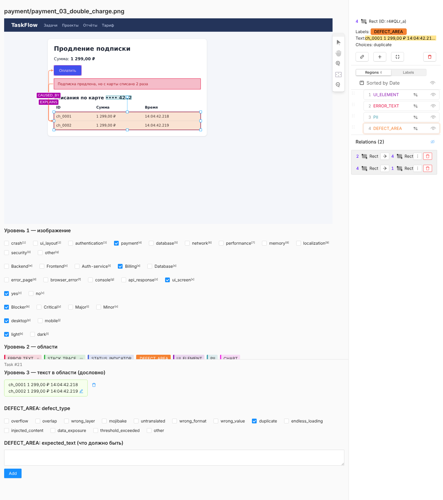
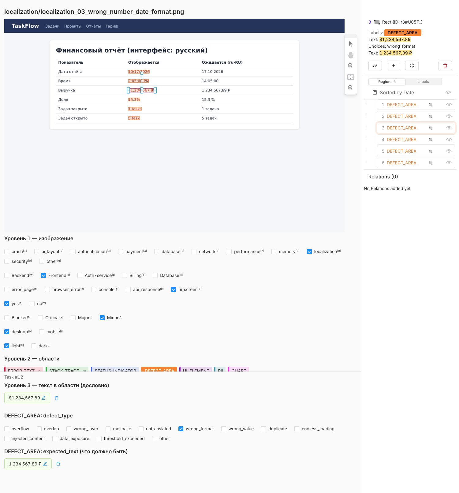
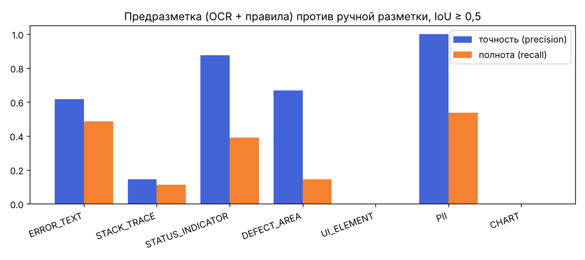
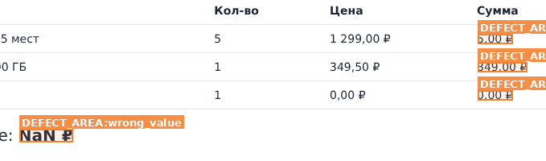
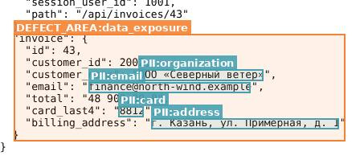
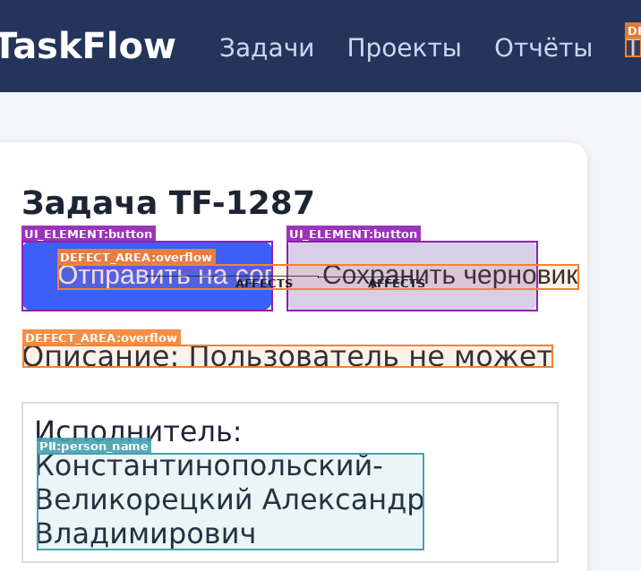
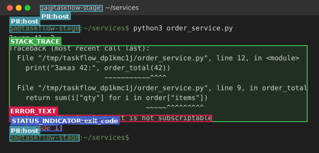
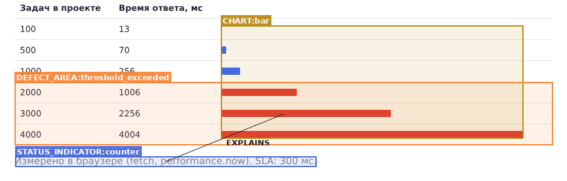
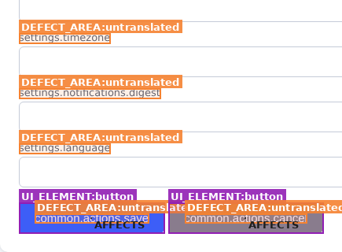
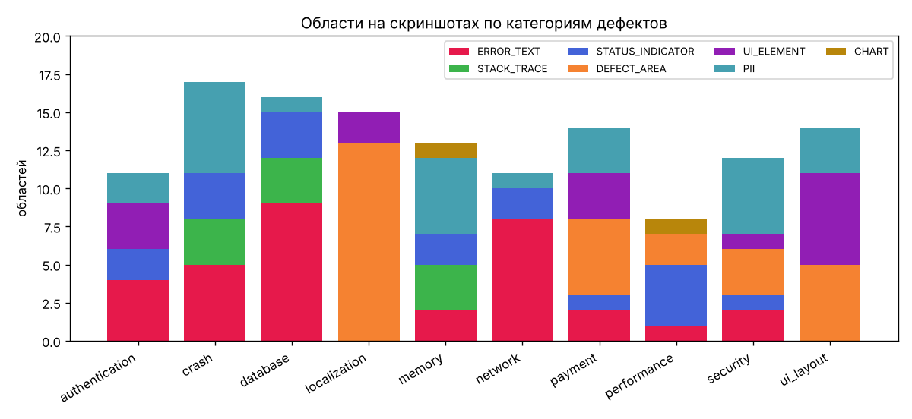

# Разметка изображений: процесс, проверка и анализ (ЛР5)

Лабораторная работа №5 «Разметка изображений» (учебное пособие «Структурирование, разметка и обогащение
данных», Муромцев Д.И., Шилин И.А., Исаев И.В.). Данные — 30 скриншотов дефектов из ЛР1
(`data/images/screenshots/`, по 3 на каждую из 10 категорий). Итоговая разметка —
[`annotations/images/screenshots_coco.json`](../annotations/images/screenshots_coco.json), подробная
статистика, которую строит скрипт, — [image_markup_stats.md](image_markup_stats.md).

| Показатель | Значение |
|---|---:|
| изображений | 30 (28 desktop, 2 mobile; 26 светлых, 4 терминала) |
| областей (прямоугольных рамок) | 131, в среднем 4,4 на изображение |
| областей с дословным текстом `ocr_text` | 114 |
| сущностей уровня 3 в тексте областей | 80 (`ERROR_MESSAGE` 26, `ERROR_CODE` 19, `EXCEPTION` 18, `METRIC` 17) |
| связей между областями | 29 (`EXPLAINS` 19, `AFFECTS` 7, `CAUSED_BY` 3) |
| экранов с дефектом / с ожидаемым поведением | 27 / 3 |

---

## 1. Инструмент и загрузка данных (шаг 1)

Инструмент — **Label Studio**, он выбран в задании 2 и уже использовался для конфигураций ЛР2.
Конфигурация проекта [`annotation_schema/label_studio/images.xml`](../annotation_schema/label_studio/images.xml)
генерируется из схемы командой `python scripts/annotation_tools.py configs` и содержит:

* классы изображения (уровень 1): `category`, `component`, `screen_type`, `is_defect`, `severity`, `device`, `theme`;
* прямоугольные области (уровень 2, `RectangleLabels`) с 7 метками;
* для выбранной области (уровень 3): дословный текст `ocr_text`, атрибуты своей метки (`defect_type`,
  `expected_text`, `ui_kind`, `pii_kind`, `status_kind`, `chart_kind`, `trend`);
* связи между областями (`Relations`: `AFFECTS`, `EXPLAINS`, `CAUSED_BY`).

Задачи для импорта — [`annotations/images/markup/labelstudio/tasks.json`](../annotations/images/markup/labelstudio/tasks.json):
30 задач, в каждой итоговая разметка (`annotations`) и предразметка (`predictions`). Изображения
подключаются как локальные файлы Label Studio (`/data/local-files/?d=data/images/screenshots/...`).
Создать проект в запущенном Label Studio и загрузить задачи можно одной командой:

```bash
pip install label-studio
LABEL_STUDIO_LOCAL_FILES_SERVING_ENABLED=true LABEL_STUDIO_LOCAL_FILES_DOCUMENT_ROOT=$(pwd) label-studio start
# зарегистрироваться (Sign up), скопировать токен в Account & Settings → Access Token
python scripts/image_markup.py ls-import --url http://localhost:8080 --token <токен>
```

Разметка выполнялась в редакторе разметки Label Studio (Label Studio Frontend из официального
репозитория HumanSignal/label-studio, сборка 1.7.3) на той же конфигурации `images.xml`. Команда
`python scripts/image_markup.py lsf --lsf <папка сборки>` открывает каждую задачу в редакторе, сохраняет
скриншоты редактора и выгружает разметку из него (`serializeAnnotation`). Выгрузка совпала с исходной
разметкой без потерь во всех 30 задачах: 589 результатов (области, тексты, атрибуты, классы, связи) — см.
[`labelstudio/roundtrip.md`](../annotations/images/markup/labelstudio/roundtrip.md) и
[`labelstudio/export_from_editor.json`](../annotations/images/markup/labelstudio/export_from_editor.json).

| Задача в Label Studio: двойное списание (`payment_03`) | Неверные форматы в русском интерфейсе (`localization_03`) |
|---|---|
|  |  |

## 2. Классы объектов и признаки (шаг 2)

**Классы объектов** — 7 меток областей. Шесть из них введены в ЛР2, `CHART` добавлена при разметке:

| Метка | Что выделяется | Признаки (атрибуты) | Областей |
|---|---|---|---:|
| `ERROR_TEXT` | сообщение об ошибке | `ocr_text` + сущности | 33 |
| `STACK_TRACE` | блок трассировки или вывода программы | — | 9 |
| `STATUS_INDICATOR` | HTTP-статус, код ошибки, индикатор загрузки, счётчик | `kind` (новый), `ocr_text` | 18 |
| `DEFECT_AREA` | место визуального или логического дефекта | `defect_type`, `expected_text` (новый) | 28 |
| `UI_ELEMENT` | элемент интерфейса, связанный с дефектом | `kind`: button, field, other… | 15 |
| `PII` | персональные и чувствительные данные | `kind`: host, card, person_name, email, address… | 26 |
| `CHART` | график или диаграмма метрики | `chart_kind`, `trend` | 2 |

**Признаки уровня изображения.** К категории, компоненту и типу экрана из ЛР2 добавлены признаки, которые
пособие приводит в шаге 2.2 («размер, цвет и другие характеристики»): `device` (desktop/mobile — по ширине
кадра), `theme` (light/dark — по яркости фона), `severity` (те же критерии, что для текста и аудио) и
`is_defect` (есть ли на экране дефект).

## 3. Предварительная разметка (шаг 3)

Предразметка полуавтоматическая (`python scripts/image_markup.py auto`):

1. **Tesseract OCR 5** (нейросетевые LSTM-модели `rus` + `eng`) распознаёт строки текста и их рамки
   на изображении, увеличенном в 2 раза;
2. **правила** по регулярным выражениям размечают строки: исключения, HTTP-статусы и коды `ERR_*` →
   `ERROR_TEXT` / `STATUS_INDICATOR`; блок от `Traceback` до исключения → `STACK_TRACE`; e-mail, номера карт,
   `user@host` в приглашении терминала → `PII`; ключи вида `settings.timezone` → `DEFECT_AREA untranslated`;
   «кракозябры» → `mojibake`; `NaN` → `wrong_value`; сущности `EXCEPTION`, `ERROR_CODE`, `METRIC`;
3. классы изображения: тема — по средней яркости, устройство — по ширине, тип экрана — по признакам на
   экране (тёмный фон, `Pretty-print`, `ERR_`, `Traceback`), категория — по ключевым словам на экране,
   компонент — по категории.

Результат — [`auto/predictions.json`](../annotations/images/markup/auto/predictions.json). Он загружается в
Label Studio как `predictions`: разметчик видит предложенные рамки и классы и исправляет их.

| Что | Качество предразметки относительно итоговой разметки |
|---|---|
| классы изображения | тип экрана, устройство, тема — 100 %; категория — 97 % (29 из 30); компонент — 80 %; `is_defect` — 90 % |
| области, IoU ≥ 0,5 | точность 0,69, полнота 0,32, F1 0,44 |
| совпавшие области | средний IoU 0,88; ошибки OCR в тексте (CER) — 2,5 % |
| сущности | 15 из 80 найдены верно |



**Вывод.** OCR хорошо находит **текст** (`PII` — точность 1,0, `STATUS_INDICATOR` — 0,88), но
**визуальные объекты** (`UI_ELEMENT`, `CHART`, большинство `DEFECT_AREA`) предразметка не видит
совсем: это элементы без текста или дефекты, понятные только по смыслу (перекрытие, слой, утечка на
графике). Для них нужна модель детекции элементов интерфейса. Предразметка экономит время на текстовых
областях и классах экрана, а визуальные области размечаются вручную.

## 4. Разметка данных (шаг 4)

Разметчик просматривал каждое изображение и рисовал рамки (поле `rough` в
[`markup/manual.json`](../annotations/images/markup/manual.json)), выбирал метку, атрибуты и связи и
записывал текст области дословно. Затем рамка подгонялась **вплотную к содержимому** (как «прилипание»
рамки в редакторе): фон берётся по периметру рамки, рамка сжимается до пикселей, которые от него
отличаются. Для части строки (PII внутри строки JSON или терминала) граница ставится по словам строки или
по ширине символа моноширинного шрифта. Команда `python scripts/image_markup.py final` собирает итоговые
координаты и смещения сущностей в `ocr_text`.

Правила, которые пришлось уточнить при разметке:

* **Перенос строк.** Перенос внутри абзаца в `ocr_text` заменяется пробелом, явные строки (строки таблицы,
  `<br>`, строки терминала) разделяются `\n`.
* **Обрезанный и искажённый текст** записывается так, как его видно: «Отправить на сог», «Т» вместо
  «Тариф», «РЈРІРµРґРѕРјР»РµРЅРёСЏ» вместо «Уведомления». Полный или правильный текст — в `expected_text`.
* **PII только значение.** В ответе API выделяется значение, а не пара ключ–значение: `8812`, а не
  `"card_last4": "8812"`. Имя пользователя и хост в приглашении терминала (`qa@taskflow-stage`) —
  `PII host`: внутренние имена серверов маскируются перед публикацией.
* **Вложенные рамки.** Код в тексте ошибки (`401 Unauthorized.` внутри сообщения) — отдельная область
  `STATUS_INDICATOR`, вложенная в `ERROR_TEXT`. Последняя строка трейсбека — `ERROR_TEXT` внутри `STACK_TRACE`.

| Неверная сумма и NaN (`payment_02`) | Чужой счёт по API, IDOR (`security_02`) | Переполнение на мобильной ширине (`ui_layout_01`) |
|---|---|---|
|  |  |  |

| Трейсбек в терминале (`crash_01`) | Время ответа выше SLA (`performance_02`) | Ключи локализации (`localization_02`) |
|---|---|---|
|  |  |  |

## 5. Проверка разметки (шаг 5)

| Проверка | Как | Результат |
|---|---|---|
| соответствие схеме | `python scripts/annotation_tools.py validate`: метки и атрибуты из словарей, рамки внутри кадра и не меньше 8 px, смещения сущностей совпадают с текстом, связи допустимы для своих меток, `severity` задана только для дефектов | ошибок нет: 30 изображений, 131 область, 29 связей ([отчёт](annotation_validation_report.md)) |
| визуальная проверка | `python scripts/image_markup.py overlay` рисует все области на изображениях; просмотрено каждое из 30 | исправлены 2 ошибки: рамки подписей полей в `localization_02` захватывали край поля ввода; PII внутри строк JSON в `security_02` были сдвинуты на символ |
| перенос в инструмент | round-trip через редактор Label Studio | 30 из 30 задач без потерь |
| разметка вслепую по эталонам ЛР2 | `database_01` и `payment_03` размечены заново без просмотра эталонов, `python scripts/image_markup.py agree --gold <эталон>` | классы 6 из 6, метки 9 из 9, тексты областей 9 из 9 совпали; F1 рамок при IoU ≥ 0,7 — 0,44, при «IoU ≥ 0,7 или стороны ±5 px» — 0,89 |

**Разбор расхождений с эталоном.**

1. Эталоны ЛР2 рисовались по высоте строки с отступом 3–5 px, новая разметка — вплотную к пикселям. Обе
   рамки укладываются в допуск схемы (5 px), но у строки высотой 11–13 px такой отступ даёт IoU 0,53–0,64.
   **Решение:** в схеме 1.2 рамки считаются совпавшими, если IoU ≥ 0,7 **или** все стороны отличаются не
   больше чем на 5 px (`quality_targets.bbox_match_rule`); так же теперь считает `annotation_tools.py agree`.
2. `DEFECT_AREA duplicate` в `payment_03`: эталон включал строку заголовка таблицы, новая разметка —
   только две повторяющиеся строки списаний. **Решение:** область дефекта — только сами повторяющиеся
   записи, без заголовка; эталон `payment_03` заменён новой разметкой (статус `gold` сохранён).

Работа выполнялась одним разметчиком, поэтому взаимная проверка в команде (шаг 5.2) заменена проверкой
вслепую по эталонам и визуальной проверкой каждого изображения. Остальные 28 изображений имеют статус
`draft` до проверки вторым участником. План — 6 изображений (20 %) для перекрёстной разметки
([журнал верификации](../annotations/VERIFICATION.md)).

## 6. Экспорт (шаг 6)

| Формат | Файл | Для чего |
|---|---|---|
| **COCO JSON** (основной) | `annotations/images/screenshots_coco.json` | обучение детекторов; атрибуты, текст, сущности и связи — в `attributes` |
| Label Studio JSON | `annotations/images/markup/labelstudio/tasks.json`, `export_from_editor.json` | импорт в Label Studio (разметка + предразметка), выгрузка из редактора |
| Pascal VOC XML | `annotations/images/markup/voc/<имя>.xml` | 1 файл на изображение, атрибуты в `<attributes>` |
| YOLO | `annotations/images/markup/yolo/labels/<имя>.txt`, `classes.txt`, `dataset.yaml` | обучение YOLO: класс и нормированные координаты |
| CSV | `annotations/images/markup/regions.csv` | одна строка = одна область, для анализа в таблицах |

## 7. Анализ результатов и изменения аннотационной схемы



**Найденные зависимости.**

1. **Тип экрана определяет, какие области на нём бывают.** На терминалах и страницах ошибок — только текст
   (`ERROR_TEXT`, `STACK_TRACE`, `STATUS_INDICATOR`): 9 из 9 трейсбеков. На обычных экранах приложения —
   27 из 28 `DEFECT_AREA` и все 15 `UI_ELEMENT`. Значит, `screen_type` (его предразметка определяет на 100 %)
   может выбирать, какой детектор запускать: OCR и правила или детектор элементов интерфейса.
2. **Категория видна по тексту, а компонент — нет.** Категория по словам на экране угадана в 29 из 30
   случаев, компонент по категории — только в 24 из 30. Расходятся случаи, где дефект находится не в
   «своём» слое: суммы счёта считает JavaScript страницы (`payment_02` → Frontend), утечка памяти во
   вкладке браузера (`memory_03` → Frontend), блокировка главного потока (`performance_03` → Frontend),
   неверная кодировка в заголовке ответа сервера (`localization_01` → Backend), сертификат и IDOR у
   биллинга (`security_01`, `security_02` → Billing). Правило ЛР3 «компонент — по месту дефекта»
   подтвердилось и для изображений.
3. **Не каждый экран с ошибкой — дефект.** Неверный пароль (`authentication_01`), истёкший токен API
   (`authentication_02`) и отказ банка (`payment_01`) — правильно показанные ошибки. Без отдельного
   признака классификатор научится считать любое сообщение об ошибке дефектом.
4. **Код объясняет сообщение.** Самая частая связь — `STATUS_INDICATOR → ERROR_TEXT` (12 из 29): код
   (`500`, `ERR_NAME_NOT_RESOLVED`, `[exit code 1]`) и текст ошибки появляются парами. Для визуальных
   дефектов связь другая — `DEFECT_AREA → UI_ELEMENT` (7): переполнение и перекрытие указывают на
   конкретную кнопку.
5. **Почти половина PII — служебные имена.** 12 из 26 областей PII — `user@host` в приглашении терминала;
   они находятся правилом без ошибок (точность предразметки PII — 1,0). Новые виды данных — адрес и
   название организации-клиента (`security_02`).
6. **Доказательство дефекта производительности и памяти — график.** Утечка видна как растущая линия
   (`memory_03`), квадратичный поиск — как столбцы выше SLA (`performance_02`). Ни одна метка ЛР2 не
   описывала график, поэтому введена `CHART`.
7. **Тонкие текстовые рамки и IoU.** Средняя площадь `PII` и `STATUS_INDICATOR` — 0,4 % кадра. Для таких
   рамок IoU слишком чувствителен (см. раздел 5), поэтому изменено правило совпадения рамок.

**Изменения аннотационной схемы (версия 1.2, обратно совместима: эталоны ЛР2 и разметка ЛР3 проходят
проверку).**

| Изменение | Откуда |
|---|---|
| признаки изображения `is_defect`, `severity`, `device`, `theme` | шаг 2.2; вывод 3 |
| область `CHART` с атрибутами `chart_kind`, `trend` | вывод 6 |
| атрибут `STATUS_INDICATOR.kind`: http_status, net_error, exit_code, loading, counter, timer | разметка: под одной меткой были разные виды статусов |
| `DEFECT_AREA.defect_type` += `injected_content` (XSS), `data_exposure` (IDOR), `threshold_exceeded` (выше SLA или лимита) | дефекты безопасности и производительности не имели своего типа |
| атрибут `DEFECT_AREA.expected_text` — что должно быть на месте дефекта | `mojibake`, `untranslated`, `wrong_format`, обрезанный текст |
| `PII.kind` += `address`, `organization` | `security_02`; вывод 5 |
| связи между областями `AFFECTS`, `EXPLAINS`, `CAUSED_BY` | вывод 4 |
| правила `ocr_text` (переносы, обрезанный текст, только значение PII) | шаг 4 |
| правило совпадения рамок: IoU ≥ 0,7 или стороны ±5 px | шаг 5, разбор расхождений |

Подробное описание — в [разделе 9 аннотационной схемы](annotation_schema.md#9-разметка-изображений-лр5).
