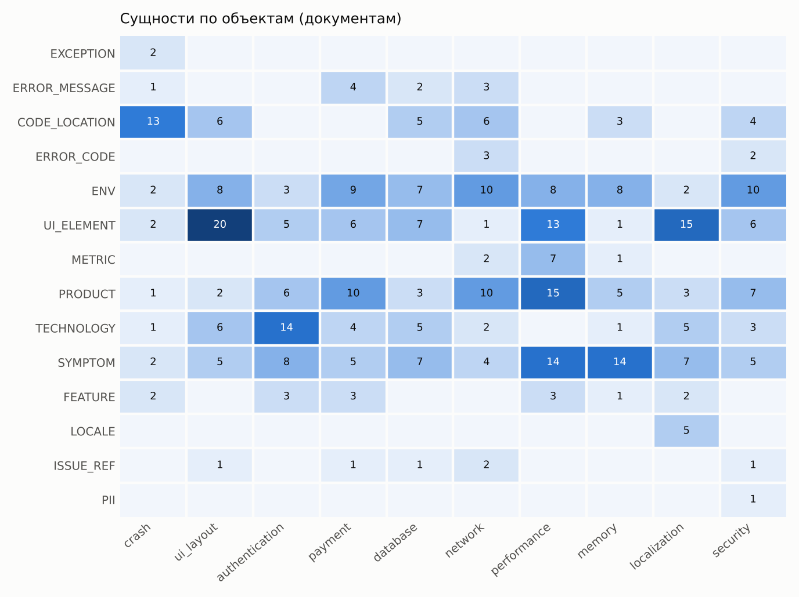
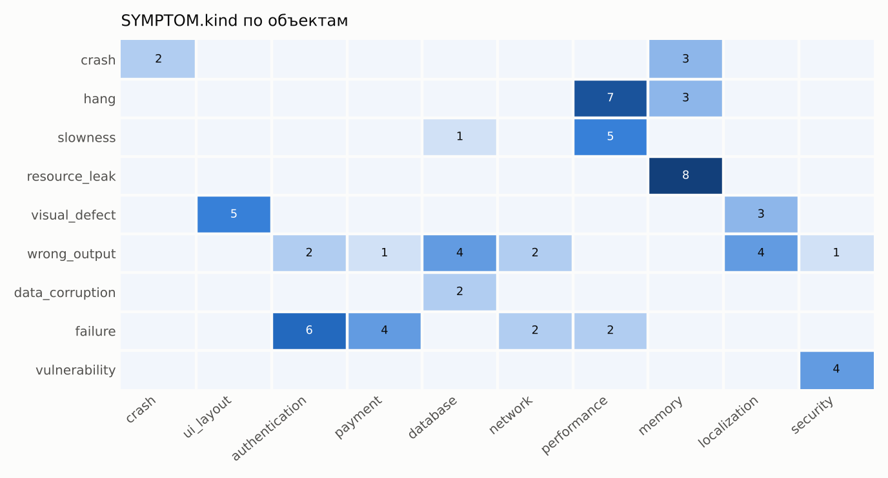
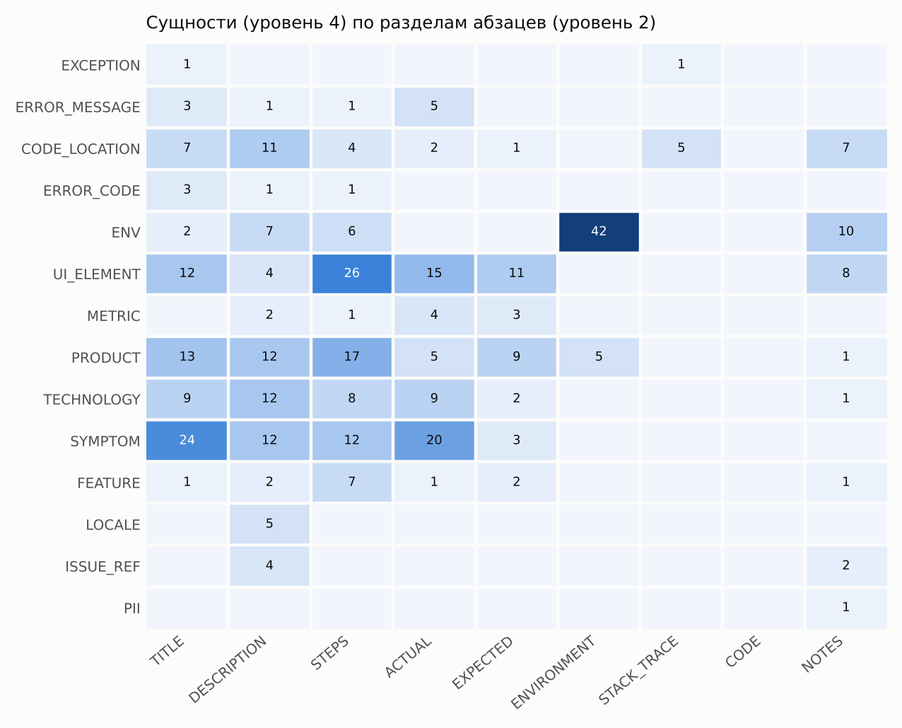
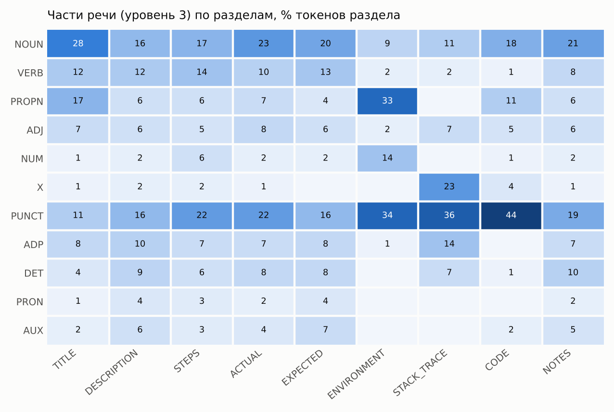
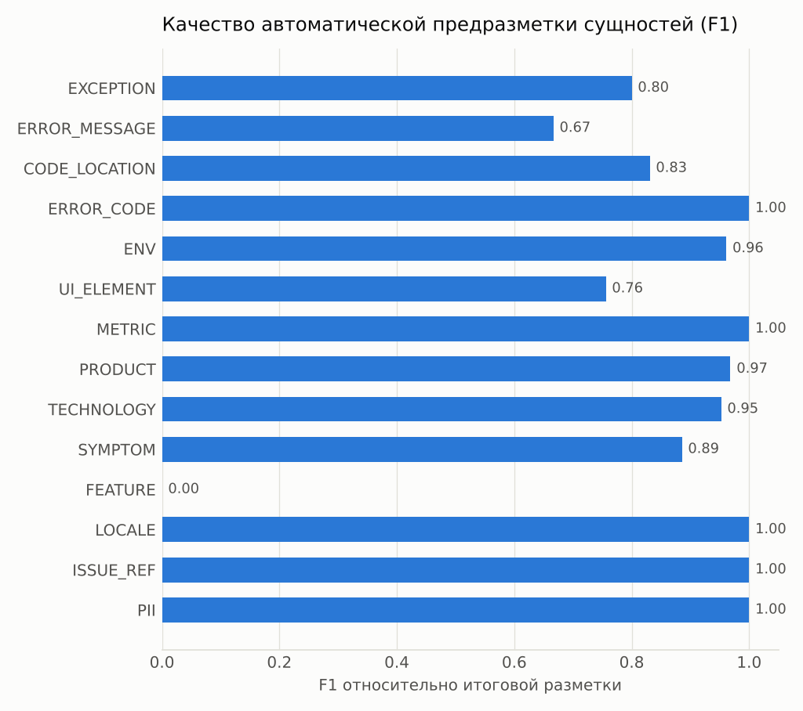

# Анализ многоуровневой разметки текстовых данных (ЛР3, шаг 6)

Создано командой `python scripts/text_markup.py analyze` (2026-10-17). Данные: `annotations/text/markup/json/` — итоговая разметка 10 документов (схема v1.1).

## 1. Корпус и объём разметки

| документ (объект) | символов | репортов | абзацев | предложений | токенов | сущностей | связей | сущн. на 100 ток. |
|---|---|---|---|---|---|---|---|---|
| crash | 2414 | 2 | 15 | 50 | 403 | 26 | 6 | 6.5 |
| ui_layout | 2216 | 2 | 17 | 32 | 378 | 48 | 8 | 12.7 |
| authentication | 2177 | 2 | 15 | 24 | 370 | 39 | 8 | 10.5 |
| payment | 2221 | 3 | 33 | 49 | 383 | 42 | 6 | 11.0 |
| database | 2299 | 2 | 17 | 43 | 435 | 37 | 5 | 8.5 |
| network | 2048 | 3 | 11 | 34 | 312 | 43 | 12 | 13.8 |
| performance | 2185 | 3 | 25 | 48 | 449 | 60 | 14 | 13.4 |
| memory | 1956 | 3 | 21 | 33 | 396 | 34 | 11 | 8.6 |
| localization | 2280 | 3 | 14 | 25 | 413 | 39 | 8 | 9.4 |
| security | 2170 | 4 | 23 | 33 | 376 | 39 | 9 | 10.4 |
| **всего** | 21966 | 27 | 191 | 371 | 3915 | 407 | 87 | 10.4 |

## 2. Типы сущностей × объекты

| объект | характерные сущности (самые частые) |
|---|---|
| crash | crashes (SYMPTOM), NullPointerException (EXCEPTION), hadoop.security.group.mapping.ldap.search.group.hierarchy.levels (CODE_LOCATION), groupResults (CODE_LOCATION) |
| ui_layout | scrollbar (UI_ELEMENT), HTML (TECHNOLOGY), .main-header (CODE_LOCATION), CSS (TECHNOLOGY) |
| authentication | Kerberos (TECHNOLOGY), OAuth 2.0 (TECHNOLOGY), Thunderbird Address Book (FEATURE), compose window (UI_ELEMENT) |
| payment | CORS / Same-origin policy (TECHNOLOGY), cross site error (SYMPTOM), Incorrect message (SYMPTOM), Import data button (UI_ELEMENT) |
| database | migration window (UI_ELEMENT), JDBC (TECHNOLOGY), malformed (SYMPTOM), invalidated (SYMPTOM) |
| network | ECONNREFUSED (ERROR_CODE), http.proxy (CODE_LOCATION), Proxy server (TECHNOLOGY), broke (SYMPTOM) |
| performance | freezes (SYMPTOM), upload file (UI_ELEMENT), tab (UI_ELEMENT), open file (UI_ELEMENT) |
| memory | memory increased (SYMPTOM), hashMap (CODE_LOCATION), Huge memory leak (SYMPTOM), consuming a large about of memory (SYMPTOM) |
| localization | sidebar (UI_ELEMENT), Bidirectional text (RTL) (TECHNOLOGY), Firefox Translations (FEATURE), GUI (UI_ELEMENT) |
| security | about:certificate (UI_ELEMENT), User-defined function (TECHNOLOGY), --archive-command (CODE_LOCATION), about:preferences#privacy (UI_ELEMENT) |

## 3. Симптомы: вид и полярность

| полярность \ раздел | TITLE | DESCRIPTION | STEPS | ACTUAL | EXPECTED | ENVIRONMENT | STACK_TRACE | CODE | NOTES |
|---|---|---|---|---|---|---|---|---|---|
| observed | 23 | 8 | 11 | 20 | 0 | 0 | 0 | 0 | 0 |
| negated | 0 | 1 | 0 | 0 | 3 | 0 | 0 | 0 | 0 |
| hypothetical | 1 | 3 | 1 | 0 | 0 | 0 | 0 | 0 | 0 |

Всего симптомов: 71. В разделе EXPECTED 3 симптомов, из них 3 — не наблюдаемые (отрицание «does not freeze», «no flicker» или желаемое поведение). Без атрибута `polarity` классификатор считал бы «Firefox does not freeze» признаком зависания — поэтому атрибут добавлен в схему 1.1.

## 4. Зависимость «раздел абзаца → тип сущности» (уровни 2 и 4)

## 5. Зависимость «часть речи ↔ раздел ↔ сущность» (уровни 2, 3, 4)

| сущность | токенов | частые UPOS |
|---|---|---|
| EXCEPTION | 2 | PROPN 50%, X 50% |
| CODE_LOCATION | 53 | X 38%, NOUN 23%, PROPN 21% |
| ERROR_CODE | 5 | PROPN 100% |
| ENV | 111 | PROPN 47%, NUM 43%, PUNCT 5% |
| UI_ELEMENT | 132 | NOUN 58%, PROPN 20%, X 7% |
| METRIC | 28 | NUM 36%, NOUN 29%, ADJ 18% |
| PRODUCT | 73 | PROPN 97%, NOUN 3% |
| TECHNOLOGY | 49 | PROPN 90%, NOUN 6%, ADP 2% |
| SYMPTOM | 133 | NOUN 34%, VERB 31%, ADJ 14% |
| FEATURE | 29 | NOUN 28%, PROPN 28%, VERB 17% |
| LOCALE | 5 | PROPN 100% |
| ISSUE_REF | 9 | NUM 33%, PROPN 33%, NOUN 22% |
| PII | 2 | PROPN 100% |

## 6. Качество автоматической частеречной разметки

Эталон — документ `memory` (396 токенов), все части речи проверены вручную. Точность UPOS: теггер NLTK (Penn → UPOS) **88.9%**, после межуровневых правил **97.7%**. Во всём корпусе правила изменили 281 из 3915 тегов (7.2%).

| правило | срабатываний | какой уровень использует |
|---|---|---|
| be_aux | 98 | токен/контекст (ур. 3) |
| name_propn | 41 | ENV/PRODUCT (ур. 4) |
| neg_part | 31 | токен/контекст (ур. 3) |
| to_adp | 24 | токен/контекст (ур. 3) |
| have_do | 19 | токен/контекст (ур. 3) |
| imperative_steps | 17 | раздел STEPS (ур. 2) |
| sconj | 17 | токен/контекст (ур. 3) |
| symptom_verb | 10 | SYMPTOM (ур. 4) |
| code_propn | 8 | CODE_LOCATION/EXCEPTION (ур. 4) |
| digits_num | 7 | токен/контекст (ур. 3) |
| please | 6 | токен/контекст (ур. 3) |
| version_num | 3 | токен/контекст (ур. 3) |

## 7. Качество предразметки сущностей и объём ручной работы

| сущность | в итоге | в предразметке | P | R | F1 |
|---|---|---|---|---|---|
| EXCEPTION | 2 | 3 | 0.67 | 1.00 | 0.80 |
| ERROR_MESSAGE | 10 | 5 | 1.00 | 0.50 | 0.67 |
| CODE_LOCATION | 37 | 28 | 0.96 | 0.73 | 0.83 |
| ERROR_CODE | 5 | 5 | 1.00 | 1.00 | 1.00 |
| ENV | 67 | 62 | 1.00 | 0.93 | 0.96 |
| UI_ELEMENT | 76 | 51 | 0.94 | 0.63 | 0.76 |
| METRIC | 10 | 10 | 1.00 | 1.00 | 1.00 |
| PRODUCT | 62 | 64 | 0.95 | 0.98 | 0.97 |
| TECHNOLOGY | 41 | 43 | 0.93 | 0.98 | 0.95 |
| SYMPTOM | 71 | 60 | 0.97 | 0.82 | 0.89 |
| FEATURE | 14 | 0 | 0.00 | 0.00 | 0.00 |
| LOCALE | 5 | 5 | 1.00 | 1.00 | 1.00 |
| ISSUE_REF | 6 | 6 | 1.00 | 1.00 | 1.00 |
| PII | 1 | 1 | 1.00 | 1.00 | 1.00 |

Всего: P = 0.96, R = 0.81, F1 = 0.88. Ручные правки: add — 78, set — 78, rel_add — 58, remove — 13, pos — 9, section — 7, rel_remove — 6, rel_confirmed — 1, replaced_by_add — 1.

## 8. Связи между сущностями

| тип | кол-во | самые частые пары типов |
|---|---|---|
| SYMPTOM_OF | 47 | SYMPTOM→PRODUCT (22), SYMPTOM→UI_ELEMENT (15), SYMPTOM→FEATURE (4) |
| CAUSED_BY | 14 | SYMPTOM→TECHNOLOGY (4), SYMPTOM→CODE_LOCATION (4), SYMPTOM→SYMPTOM (2) |
| OBSERVED_IN | 12 | ERROR_CODE→ENV (4), ERROR_MESSAGE→ENV (3), METRIC→ENV (2) |
| VERSION_OF | 10 | ENV→PRODUCT (10) |
| HAS_MESSAGE | 3 | ERROR_CODE→ERROR_MESSAGE (3) |
| THROWN_AT | 1 | EXCEPTION→CODE_LOCATION (1) |

Связей всего 87, из них между разными предложениями — 28 (32%): поэтому слой связей в INCEpTION настроен с `cross_sentence = true`.

## 9. Окружение из строки User-Agent

| проект | ENV из UA | affected=yes | unknown |
|---|---|---|---|
| firefox | 10 | 10 | 0 |
| thunderbird | 13 | 4 | 9 |

В репортах Bugzilla поле User-Agent описывает браузер, из которого отправлен отчёт. Для Firefox это и есть окружение дефекта, а для Thunderbird — нет (в UA виден Firefox или Chrome автора). Поэтому в схему добавлен атрибут `ENV.source`, а браузер из UA в отчётах Thunderbird получает `affected=unknown`.

## 10. Трекер → структура документа (уровень 1 → уровень 2)

| трекер | TITLE | DESCRIPTION | STEPS | ACTUAL | EXPECTED | ENVIRONMENT | STACK_TRACE | CODE | NOTES |
|---|---|---|---|---|---|---|---|---|---|
| Apache Jira | 7 | 16 | 2 | 1 | 1 | 0 | 1 | 3 | 8 |
| GitHub Issues | 2 | 1 | 4 | 1 | 0 | 2 | 0 | 1 | 2 |
| Mozilla Bugzilla | 18 | 10 | 30 | 24 | 26 | 21 | 0 | 0 | 10 |

Шаблон Bugzilla даёт явные разделы STEPS/ACTUAL/EXPECTED, а в Jira и GitHub преобладают DESCRIPTION, CODE и NOTES. Значит, признаки на основе разделов надо нормировать по трекеру.

## 11. Связывание с DBpedia (семантический уровень)

Ссылку на ресурс DBpedia получили 126 из 175 сущностей PRODUCT/TECHNOLOGY/ENV/LOCALE (72%), различных ресурсов — 39. Самые частые: dbr:Firefox (13), dbr:Mozilla_Thunderbird (11), dbr:Microsoft_Windows (11), dbr:MacOS (8), dbr:Kerberos_(protocol) (6), dbr:OAuth (5), dbr:Visual_Studio_Code (5), dbr:PayPal (5), dbr:Java_Database_Connectivity (4), dbr:Apache_Spark (4). Без ссылки остались версии продуктов (ENV app_version) и внутренние функции (Marketplace, Supernova), для которых в DBpedia нет отдельной статьи.

## 12. Предразметка категорий при отборе текстов

При отборе прочитано 36 репортов-кандидатов; у 7 из них категория, назначенная по ключевым словам заголовка (`scripts/categories.py`), оказалась ошибочной или спорной (например, «Network Settings panel» в заголовке дал категорию network для дефекта вёрстки). Ключевых слов заголовка недостаточно: нужны признаки SYMPTOM.kind, UI_ELEMENT и TECHNOLOGY из тела репорта.

## 13. Выводы: найденные зависимости и изменения аннотационной схемы (шаг 6.2)

| найдено при анализе | изменение схемы 1.0 → 1.1 |
|---|---|
| тип раздела предсказывает тип сущности: ENV почти только в ENVIRONMENT/NOTES, UI_ELEMENT — в STEPS, SYMPTOM — в TITLE и ACTUAL (п. 4) | раздел абзаца стал отдельным уровнем разметки (слой Section); правило: внутри CODE/цитат сущности не размечаются |
| симптомы в EXPECTED и после отрицаний не наблюдаются («Firefox does not freeze») (п. 3) | атрибут `SYMPTOM.polarity` = observed / negated / hypothetical |
| ENV из User-Agent в отчётах Thunderbird — браузер автора, а не окружение продукта (п. 9) | атрибут `ENV.source` = text / user_agent; affected=unknown для чужого браузера |
| для локализации нет сущности языка; языки попадали в PRODUCT или терялись | сущность `LOCALE` (код BCP 47, ссылка DBpedia) |
| многие UI_ELEMENT на деле функции (Address Book, Payment methods, Translations) (п. 7: предразметка FEATURE R=0) | сущность `FEATURE`; кандидат на автоматическое правило в следующей версии |
| авторы называют причину симптома (memory leak → freezing, messageBody.css → not rendered) (п. 8) | связь `CAUSED_BY`; `SYMPTOM_OF`, `VERSION_OF`; `OBSERVED_IN` принимает SYMPTOM и LOCALE |
| коды ошибок и продукты встречаются внутри текста сообщения | вложение сущностей разрешено только внутри ERROR_MESSAGE |
| теггер ошибается на повелительных глаголах в STEPS, глаголах-симптомах и идентификаторах кода (п. 6) | правила `text_markup.rules` (POS с учётом раздела и сущности): точность UPOS с 88,9% до 97,7% |
| ключи конфигурации (hadoop.security…, --archive-command) — частая причина дефекта | `CODE_LOCATION.kind = config` |
| ссылки на другие тикеты (bug 1826149, SPARK-21551) | сущность `ISSUE_REF` — для связей тикетов в графе знаний (ЛР6) |

